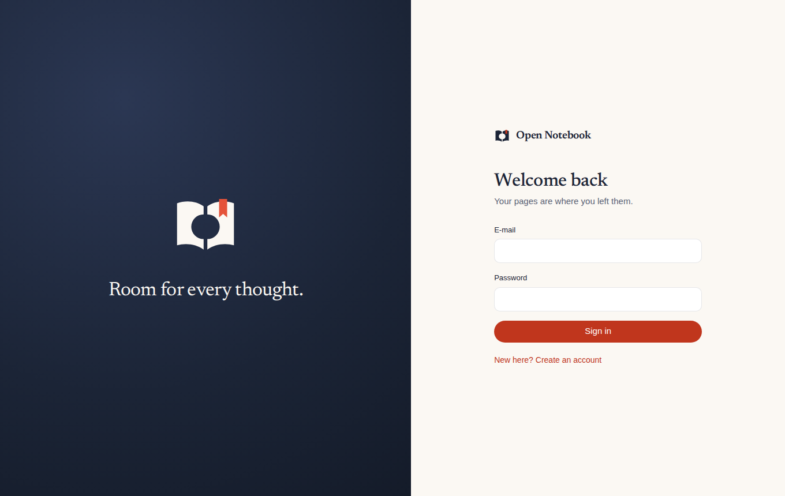
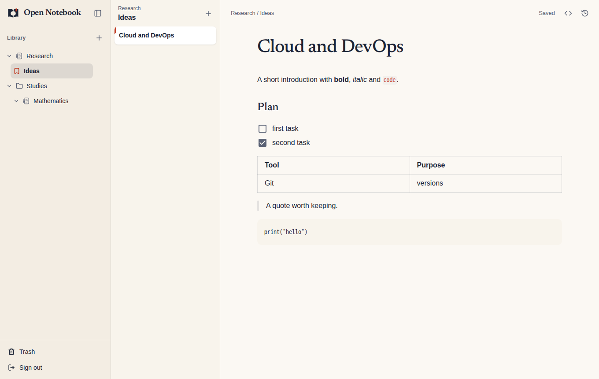
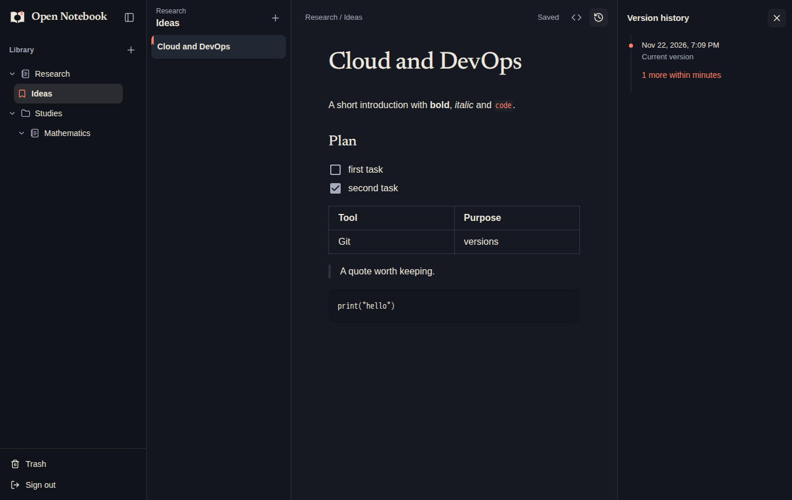
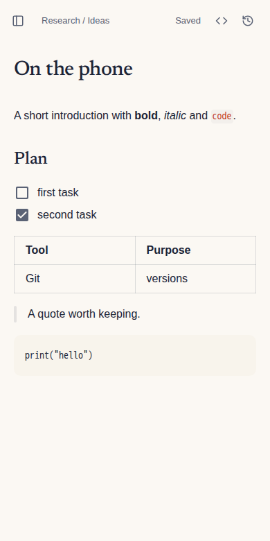

# Phase 3 – User interface

- **Date:** 2026-11-22
- **Commit:** `0db814a7`
- **CI run:** [45059276798](https://github.com/ISlothI/open-notebook/actions/runs/45059276798) (all jobs passed; screenshots, JUnit and traces are attached as `e2e-reports`)

## Spike: Markdown fidelity of the rich text editor

14 cases. Ten notations come back unchanged; four are rewritten to an equivalent notation once (`-` to `*` lists, `---` to `***`, escaped special characters, collapsed blank lines) and stay stable afterwards. Opening a page never saves it, so the rewriting happens only together with a real edit. The spike became a permanent test (`web/src/editor/markdown.test.ts`).

## Browser tests (`make e2e`, Chromium, production images)

```text
20 passed (23.6s)
```

| Flow | Tests |
|---|---|
| F1 | write, version and restore; autosave; opening creates no version; source mode |
| F4 | delete and recover; restore to another place |
| R3 | edit conflict with both decisions, both texts remain in the history |
| Other | offline draft, outage message, sign-in, rename, reorder, move, drag |

## Accessibility

axe reports no violations on the sign-in, empty, page, version and trash views in light and dark mode, and on the narrow page view. Lists and buttons generated inside the third-party editor are excluded (documented in `accessibility.spec.ts`, review by 2027-06-30). axe finds only a part of the possible problems; no test with a screen reader was made.

## Appearance

| | |
|---|---|
|  |  |
|  |  |
