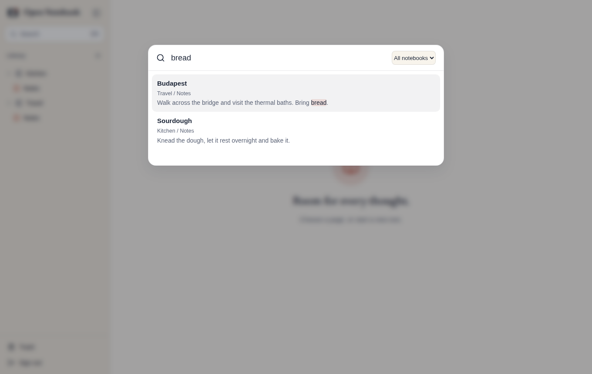

# Phase 4 – Search

- **Date:** 2026-11-22
- **Commit:** `50be4b52`
- **CI run:** [45061573692](https://github.com/ISlothI/open-notebook/actions/runs/45061573692) (all jobs passed)

## Tests

```text
make test:  144 passed, total coverage 98%, domain and application 99%
make e2e:   23 passed
```

| Flow or property | Tests |
|---|---|
| F2 search by meaning | `search.spec.ts` (browser), `test_search.py` |
| F4, search part | `test_f4_trashed_page_is_not_found_until_restored` |
| R2 embedder outage | `test_r2_search_works_without_the_embedder_and_catches_up` |
| Queue | one winner per job among concurrent workers, takeover after lease expiry, fencing, merging, transactional enqueue |
| Isolation | `test_other_users_notes_are_never_found` |

## Search quality (real model, 20 pages, 23 queries in two languages)

```text
recall@5=0.91 MRR=0.91 not first={'saving money': None, 'mortgage payments': None}
unrelated: {'quantum chromodynamics': 0, 'zzzz qqqq': 0, 'submarine sonar repair': 0, 'opera libretto 1786': 0}
```

Thresholds: recall@5 ≥ 0.90, MRR ≥ 0.75. The sample is small and the distance limit was chosen on it, so this is a regression guard rather than a measurement of general quality. See [ADR 0004](../adr/0004-hybrid-search-in-postgresql.md) for the model comparison.

## R2 on the running stack (production images)

```text
embedder stopped:  {"mode":"fulltext","hits":[]} 200 0.062 s, 0.020 s, 0.011 s
embedder started:  {"mode":"hybrid","hits":[]}   200 0.091 s
```

## Measured memory of the embedder

458 MiB with the `tokenizers` library, 230 MiB with SentencePiece (after the browser tests, one sample each).


