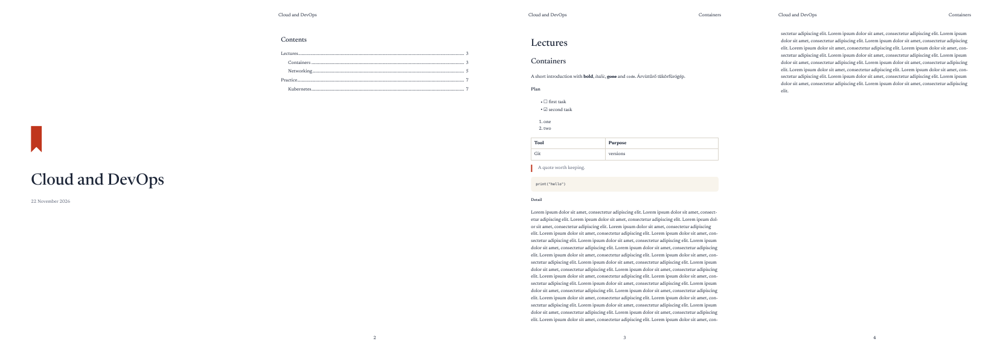
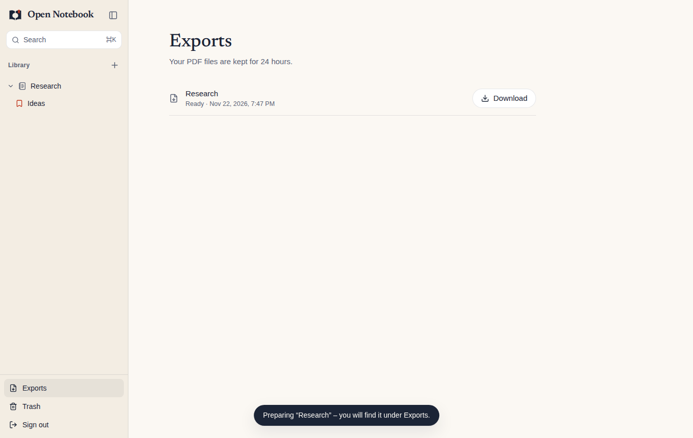

# Phase 5 – PDF export

- **Date:** 2026-11-22
- **Commit:** `2111b6df`
- **CI run:** [45063546595](https://github.com/ISlothI/open-notebook/actions/runs/45063546595) (all jobs passed)

## Tests

```text
make test:  164 passed, total coverage 98%, domain and application 99%
make e2e:   25 passed
```

| Flow or property | Tests |
|---|---|
| F3 export and download | `export.spec.ts` (browser), `test_f3_notebook_is_exported` |
| Table of contents with correct page numbers, bookmarks | `test_notebook_has_cover_contents_pages_and_bookmarks` |
| R1 worker crash | `test_r1_export_of_a_crashed_worker_is_finished_once` |
| No outgoing requests (SSRF) | `test_rendering_never_requests_anything` |
| Snapshot, privacy, expiry, size limit, idempotence, cleanup | `test_exports.py` |

The SSRF test was verified by removing the protection; it then failed with `assert ['/image.png'] == []`.

## R1 on the running stack (production images)

A 20-page notebook was exported and the worker killed with `SIGKILL` while the export was running:

```text
  1.1s before kill: running 20%
  1.3s SIGKILL sent, worker: exited exit=137
  1.5s new worker started, export: running
 40.0s export: succeeded, 38.6s after the kill
pdf bytes 411825 b'%PDF-'
jobs: succeeded|2|1        (state, attempts, crashes)
```

The recovery time consists of the remaining lease (30 s) and the repeated rendering (about 9 s). In the first run of this exercise the export had to wait 31 s before it started, because indexing occupied every worker thread; since then each kind of job has its own thread.

## Appearance




