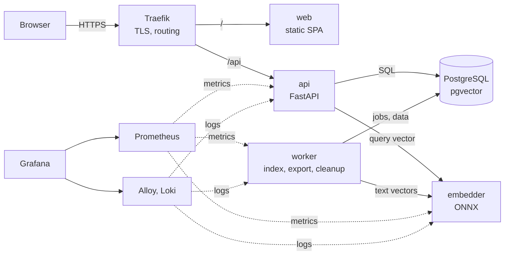

# Open Notebook – project plan

| | |
|---|---|
| Status | Decisions D1–D7 confirmed; simplified after phase 0 (D7) |
| Date | 2026-11-22 |
| Scope | Design of the application and of the complete DevOps process |

Memory, performance and time figures in this document are **design estimates** until a measurement in `docs/evidence/` supports them.

## Contents

1. [Goal and scope](#1-goal-and-scope)
2. [Constraints](#2-constraints)
3. [User flows](#3-user-flows)
4. [Architecture](#4-architecture)
5. [Data model and business rules](#5-data-model-and-business-rules)
6. [Background jobs, search, PDF](#6-background-jobs-search-pdf)
7. [User experience and identity](#7-user-experience-and-identity)
8. [Repository and local environment](#8-repository-and-local-environment)
9. [Testing and CI](#9-testing-and-ci)
10. [Supply chain and secrets](#10-supply-chain-and-secrets)
11. [Deployment, environments, GitOps](#11-deployment-environments-gitops)
12. [IaC and configuration management](#12-iac-and-configuration-management)
13. [Observability and SLOs](#13-observability-and-slos)
14. [Reliability and recovery](#14-reliability-and-recovery)
15. [AI-assisted workflow](#15-ai-assisted-workflow)
16. [Implementation phases](#16-implementation-phases)
17. [Requirements traceability](#17-requirements-traceability)
18. [Risks](#18-risks)
19. [Decisions and manual steps](#19-decisions-and-manual-steps)

## 1. Goal and scope

Open Notebook is a structured, Markdown-based note-taking application in which notes are not lost (versions, trash), can be found by meaning (hybrid search), and can be taken away as a well-designed PDF.

**In scope:** the six specified feature groups, minimal sign-in, and the full DevOps scope of the assignment.

**Out of scope:** real-time collaboration, sharing, file attachments, mobile apps, public cloud hosting, e-mail delivery. They are too large for one person or do not add to the assessed capabilities.

## 2. Constraints

| Fact (surveyed 2026-11-22) | Design consequence |
|---|---|
| Apple Silicon (arm64), 8 GB RAM | Lightweight components, fixed memory budget |
| Docker VM: 8 CPUs, about 3.8 GiB | The cluster must fit; 5 GB is comfortable |
| About 27 GB free disk | Slim images, short retention |
| No Homebrew, Node, Helm, OpenTofu or Ansible | Tools run from a versioned **toolbox container**; nothing is installed on the host |
| Public, empty GitHub repository | Free Actions, GHCR and public attestations are available |
| The evaluator's environment is unknown | Only Docker, git and make are required; images for `amd64` and `arm64` |

## 3. User flows

| # | Flow | Steps | Automated verification |
|---|---|---|---|
| F1 | Write, version, restore | create folder, notebook, section, page → two saves → compare versions → restore the first as a new version | Playwright, API test |
| F2 | Search by meaning | save → worker indexes → a query in different words finds it → filter by notebook | Playwright, search quality test |
| F3 | Export a notebook | start export → follow status → download → the PDF has a table of contents and page numbers | Playwright, PDF parsing test |
| F4 | Delete and recover | notebook to trash → disappears from the tree and search → restore → searchable again | Playwright, API test |
| **R1** | Worker crash during export | kill the worker → lease expires → another instance finishes; no duplicate result | Integration test, cluster exercise |
| **R2** | Embedder outage | search falls back to full-text and says so → saving keeps working → missed indexing catches up after recovery | Integration test, cluster exercise |
| **R3** | Edit conflict | two tabs save the same page → the second gets `409` → both texts are kept, the user decides | API test, Playwright |
| **R4** | Total cluster loss | delete cluster → rebuild from code → restore data from backup → verify | DR exercise with measured RTO/RPO |

## 4. Architecture



| Component | Technology | Why |
|---|---|---|
| `web` | React, TypeScript, Vite; served statically from a non-root container | Rich editor UI, independently scalable and cacheable |
| `api` | Python, FastAPI, SQLAlchemy, Alembic | Typed, produces an OpenAPI contract; Python also has the search and PDF ecosystem |
| `worker` | Same image as `api`, different command | Slow work does not block the API; scales and fails separately |
| `embedder` | Same image, different command; ONNX Runtime, `multilingual-e5-small` (quantised) | Handles multilingual notes on CPU; the model is in memory once per environment |
| Data | PostgreSQL with pgvector | Durable data, full-text index, vectors and job queue in **one** transactional system |

### 4.1 Main decisions (to be written as ADRs)

| ADR | Decision | Rejected alternative and reason |
|---|---|---|
| 0001 | Monorepo | Several repositories: only synchronisation overhead for one person |
| 0002 | One modular Python codebase and image, three processes (api, worker, embedder) | Microservices: no independent teams or release cadence; separate images would triple building, scanning and signing |
| 0003 | PostgreSQL job queue (`SKIP LOCKED`, leases) | Redis/RabbitMQ: extra state and memory; loses the shared transaction with the save |
| 0004 | pgvector and PostgreSQL FTS, RRF fusion | Elasticsearch/Qdrant: exceeds the memory budget, causes dual writes |
| 0005 | Separate embedder process | Model inside api and worker: double memory, no clean failure boundary |
| 0006 | PDF with WeasyPrint | Headless Chromium: large image and memory; WeasyPrint natively supports a paginated table of contents |
| 0007 | Finished PDFs in PostgreSQL with expiry, behind a port | Object storage: a separate stateful system for short-lived small files. The port allows switching to S3 |
| 0008 | Flux CD | Argo CD: higher memory use because of its UI. Flux natively verifies cosign signatures, handles dependencies and automatic rollback |
| 0009 | The unit of release is a signed OCI Helm chart containing image digests | Separately moving image tags: no guarantee that they belong together |
| 0010 | Secrets generated at installation | SOPS/Sealed Secrets: the evaluator could not reproduce the environment without the private key |
| 0011 | Layers: Ansible (host, k3d) → OpenTofu (cluster base) → Flux (application) | Everything in one tool: mixed life cycles; a provider depending on the cluster cannot be configured reliably in the plan that creates it |
| 0012 | Toolbox container | Host-installed tools: not reproducible, and host installation is avoided |
| 0013 | Session cookie and ownership filtering | External identity provider: disproportionate |

### 4.2 Code structure

The backend uses ports and adapters; dependencies always point inwards. Ports exist only where a test substitute or a second implementation is needed.

```text
domain/          entities, value objects, rules (pure Python)
application/     use cases, ports (Protocol): PageRepository, JobQueue,
                 EmbeddingProvider, DocumentRenderer, ArtifactStore, Clock
infrastructure/  adapters: postgres, embedder client, weasyprint
entrypoints/     api (FastAPI), worker, embedder
```

A new export or job type is added by registering a handler, without changing the processing loop (open/closed principle).

### 4.3 Memory budget (estimate)

| Item | MiB |
|---|---:|
| k3s control plane, Traefik | 550 |
| Flux (4 controllers) | 180 |
| Prometheus, Grafana, Loki, Alloy, kube-state-metrics | 580 |
| prod: PostgreSQL, api ×2, worker, embedder, web | 835 |
| staging: the same with api ×1 | 705 |
| Docker VM baseline | 350 |
| **Total** | **3200** |

This fits in 3.8 GiB with little headroom. E2E tests and full exercises therefore also run on CI runners; locally, `PROFILE=lite` scales staging down.

## 5. Data model and business rules

| Table | Content |
|---|---|
| `users`, `sessions` | account (Argon2id password hash), hashed session identifier |
| `nodes` | tree: `id, owner_id, kind, parent_id, parent_kind, title, position, trashed_at, trash_root_id` |
| `pages` | `node_id, current_version_id` |
| `page_versions` | append-only: `page_id, number, title, content_md, content_hash, restored_from` |
| `search_chunks` | `page_id, version_id, notebook_id, owner_id, text, tsv, embedding vector(384)` |
| `jobs` | `kind, payload, dedupe_key, state, attempts, run_after, leased_until, progress, error` |
| `exports` | `job_id, scope_node_id, state, artifact, expires_at` |

**Hierarchy.** A folder lives in a folder or at the root; a notebook in a folder or at the root; a section in a notebook; a page in a section. A composite foreign key (`parent_id, parent_kind`) and a `CHECK` enforce this; the use case checks for cycles under a lock.

**Versions.**
- Every save is a new, immutable version. A repeated request with identical content creates no new version (idempotence).
- A save carries its base version; on mismatch the server answers `409 Conflict` and overwrites nothing.
- Restoring creates a new version with the old content, so it can itself be undone.
- The editor saves automatically when idle; unsaved text survives closing the tab as a local draft. The timeline groups versions close in time.

**Trash.**
- Deleting puts the whole subtree under one `trash_root_id`; the trash shows only the roots.
- An item deleted separately earlier keeps its own root, so restoring the parent does not bring it back.
- If the parent of the item to restore is in the trash, the API answers `409 parent_trashed` and the UI offers a new location.
- The worker deletes permanently after 30 days. Trashed content is not searchable.

**Access.** Every query is filtered by owner; accessing another user's item returns `404`. The session cookie is `HttpOnly`, `Secure` and `SameSite`; state-changing requests are CSRF-protected, and sign-in attempts are rate-limited.

## 6. Background jobs, search, PDF

**Job queue.** A job is created in the **same transaction** as the triggering operation. The worker claims jobs with `FOR UPDATE SKIP LOCKED`, is woken by `LISTEN/NOTIFY`, holds a lease and sends heartbeats. On failure it backs off exponentially with jitter; after the last attempt the job becomes `dead`, visible in a metric and an alert. Execution is at-least-once, so every handler is idempotent. On `SIGTERM` the worker takes no new work and returns its lease.

**Indexing.** Save → `index_page` job (coalesced per page) → Markdown is chunked by headings → vectors → old chunks are replaced in one transaction, only if the version is still the latest.

**Search.** Full-text (Hungarian and English stemming, accent-insensitive, because notes may be in either language) and vector (cosine) queries run in parallel; Reciprocal Rank Fusion merges them, with highlighted snippets. Vector search is exact at first because the number of chunks per user is small; an HNSW index is added only based on measurement. If the embedder fails or times out, the response has `mode: "fulltext"` and the UI shows it.

**Search quality.** A fixed Hungarian/English sample set; CI fails if recall@5 or MRR drops below the threshold.

**PDF export.** `queued → running (progress %) → succeeded | failed → expired`. Markdown → HTML (raw HTML disabled, output sanitised) → WeasyPrint. Cover, table of contents with page numbers, PDF bookmarks, running header. The renderer **may not load any external resource** (SSRF protection). The download link is signed and expires; a cleanup job deletes the file. The content is a snapshot of the versions at the time of the request.

## 7. User experience and identity

**Core idea: "open page, quiet space".** Generous space, precise typography, translucent layers and restrained motion come from Apple; the product's own voice is the warmth of paper and ink.

- **Logo:** two curved pages of an open notebook whose negative space forms an "O"; a bookmark-sized strip of colour at the spine. SVG, monochrome and favicon variants.
- **Colours:** warm paper white and deep ink blue, with a single vivid accent (vermilion bookmark). Dark mode uses "desk at night" shades. Every pair has WCAG AA contrast.
- **Type:** system font for the UI; a self-hosted, freely licensed book face for page titles and the PDF.
- **Layout:** three collapsible columns (library, page list, editor); focus mode; stacked sliding views on narrow screens.
- **Key surfaces:** ⌘K search and command palette, drag-and-drop tree, version timeline with comparison, trash, export centre, expressive empty states.
- **Editor:** Markdown-native WYSIWYG (Milkdown) and a raw Markdown mode. A spike at the start of phase 3 verifies Markdown round-trip fidelity; if inadequate, CodeMirror with live preview.
- **States:** save indicator, offline draft, degraded search, conflict resolution – every error has a human message and a next step.
- **Accessibility:** full keyboard operation, visible focus, `prefers-reduced-motion`, axe checks in the E2E tests.
- **Language:** English, from a single message catalogue so that further languages can be added.

## 8. Repository and local environment

```text
.
├── CLAUDE.md  README.md  Makefile  VERSION
├── .github/workflows/
├── backend/            Python: api, worker, embedder (src/, tests/, migrations/, uv.lock)
├── web/                React application, Playwright tests
├── compose/            development environment, reverse proxy
├── deploy/
│   ├── chart/          Helm chart: application, PostgreSQL, backup
│   ├── platform/       observability
│   ├── envs/           staging/, prod/   ← the desired state
│   └── flux/           Flux sources and dependencies
├── infra/
│   ├── ansible/        host preparation, k3d, operations playbooks
│   └── tofu/           cluster base
├── observability/      rules, dashboards, promtool tests
├── load/               k6 scenarios
├── tools/toolbox/      image with pinned tools
└── docs/               adr/ ai/ evidence/ runbooks/ incidents/ architecture.md security.md slo.md
```

**Development:** `git clone` → `make dev`. The target creates a gitignored `.env` with random values, builds the images, migrates and loads sample data. Hot reload for api and web; health checks and start order in Compose. It runs behind the reverse proxy with TLS, so the development path mirrors the deployed one.

**Toolbox:** one multi-stage image definition with checksum-verified, pinned tools, used both locally and in CI. The `lint` target holds the check tools (gitleaks, actionlint, hadolint, shellcheck); the `ops` target adds the deployment tools (k3d, helm, flux, tofu, ansible, cosign, syft, trivy, k6, kubeconform, promtool) in the phases that need them. Only `ops` gets the Docker socket, whose mounting grants administrator-level access to the host; this is acceptable only on a development machine and is recorded in `docs/security.md`.

## 9. Testing and CI

| Level | What it proves | Tool |
|---|---|---|
| Unit | domain and application rules | pytest, Vitest |
| Integration | real PostgreSQL: queue, lease, transaction, search, ownership filtering | pytest with a service container |
| Contract | the web client matches the API; CI fails if the generated types are stale | TypeScript types generated from OpenAPI |
| Migration | from an empty database; models and migrations agree | Alembic |
| Search quality | recall@5 and MRR thresholds | fixed sample set |
| E2E | F1–F4, R3 and accessibility | Playwright, axe |
| Deployment | chart validity, security settings | helm lint, kubeconform, Trivy config |
| Observability | correctness of alert rules | promtool test rules |
| Clean room | cluster, deployment and smoke test on an empty runner | k3d in CI |

Coverage thresholds: domain and application layers 90%, backend overall 80%.

**Workflows**

| Workflow | Trigger | Task |
|---|---|---|
| `ci` | PR, weekly | gates, lint, types, tests, image build, vulnerability scanning, E2E |
| `clean-room` | PR (touching deployment), weekly | cluster from scratch, smoke test, backup–restore exercise |
| `release` | push to `main` | build, scan, SBOM, signing, chart, staging version update |
| `promote` | manual | prod PR with the same chart version, release notes |

Test results, coverage, Playwright traces, SBOMs and scan reports are available as CI artifacts.

## 10. Supply chain and secrets


- **Version:** `VERSION` (MAJOR.MINOR) plus the run number, e.g. `0.1.57`. Every application change merged to main is a full release candidate; promotion does not rebuild.
- **Chain of trust:** Flux accepts only charts signed by this repository's `release` workflow; the chart pins images by digest, so the verification extends to them.
- **Gates:** a fixable HIGH/CRITICAL vulnerability stops the release; exceptions need a justification and an expiry date.
- **Negative evidence:** an attempt to deploy an unsigned chart fails, and this is documented.
- **Updates:** Dependabot for Python, npm, Docker and Actions dependencies.

**Secrets.** There is no long-lived secret in Git or GitHub Secrets: GHCR uses the runtime `GITHUB_TOKEN`, signing uses OIDC. OpenTofu generates database passwords, the signing key and the Grafana password as ephemeral values through write-only attributes, so they do not enter the state either. Rotation: increase the revision and restart; with an exercised runbook. gitleaks runs before commits and on the full history in CI.

## 11. Deployment, environments, GitOps

**Separation.** `open-notebook-staging` and `open-notebook-prod` namespaces: separate database, secrets, quota, host name, default-deny NetworkPolicy and the `restricted` Pod Security level. They share one cluster because of the memory budget; an ADR states this limitation (shared control plane).

| | staging | prod |
|---|---|---|
| Address | `https://staging.open-notebook.localhost:8443` | `https://open-notebook.localhost:8443` |
| api replicas | 1 | 2 with PodDisruptionBudget |
| Update | automatic commit after a successful release | manual promotion with an approved PR |
| Backup | none (sample data) | hourly |

**Release process**
1. The `release` workflow commits the new chart version to `deploy/envs/staging`. A push made with `GITHUB_TOKEN` starts no new workflow, so there is no loop and no extra credential.
2. Flux verifies the chart signature and deploys it. An init container migrates the database under an advisory lock before the api starts.
3. The `promote` workflow opens a PR that sets the same version in `deploy/envs/prod`, after checking the signature. Merging it is the approval.

**Rollback.** Automatic: if the new pods do not become ready, Flux rolls back to the previous release. Manual: `git revert` of the version commit. Both are exercised with a deliberately broken release. The database is not rolled back: thanks to expand/contract migrations the previous version runs on the new schema.

**Drift handling.** After a manual `kubectl scale`, Flux restores the desired state; the experiment is recorded as evidence.

## 12. IaC and configuration management

| Layer | Tool | Responsibility | Proof of reproducibility |
|---|---|---|---|
| Host | Ansible | prerequisites, local CA and certificate, directories, k3d cluster from declarative config; backup, restore and DR playbooks | second run is `changed=0`, checked in CI |
| Cluster base | OpenTofu | namespaces, quotas, Pod Security, secrets, TLS, Flux installation | `plan -detailed-exitcode` = 0 after apply |
| Application | Flux, Helm | everything running in the namespaces | Flux `Ready`, drift experiment |

The OpenTofu state is local and gitignored: there is one user, the cluster is disposable, and remote storage would be an external dependency. The provider lockfile is committed with hashes for several platforms. The code is checked with `tofu validate` and Trivy.

## 13. Observability and SLOs

- **Metrics:** HTTP RED; queue depth, age, duration and outcome; search mode and time per stage; embedder time; export outcome; PostgreSQL connections; `build_info` with version.
- **Logs:** JSON with uniform fields (`ts, level, service, version, env, request_id, job_id, event`). The `request_id` can be followed from the browser to the background job. Note content and search terms are **not** logged.
- **Dashboards as code:** service overview, SLO and error budget, job queue.
- **Alerts:** multi-window error budget burn, queue age, `dead` jobs, stale backup; each with a runbook link and a promtool test. Notifications appear locally on the Prometheus/Grafana UI; there is no external channel.

| SLI | SLO (28 days, initial target) |
|---|---|
| Ratio of non-5xx API responses | 99.5% |
| Search under 500 ms | 95% |
| Searchable within 30 s of saving | 95% |
| Export successful within 60 s | 98% |

Targets are finalised after the load measurement. A short-lived local cluster does not collect 28 days of data; the evidence states this and shows compliance for the load window.

## 14. Reliability and recovery

- **Load (k6):** baseline, peak, soak; thresholds are the SLOs. Identify the saturation point and bottleneck, with at most one measurement-based improvement and before/after data.
- **Failure exercises:** R1, R2, database restart, faulty release. Each has a hypothesis, execution, detection, impact and recovery time.
- **Backup:** hourly `pg_dump` with checksum, into a directory outside the cluster (it survives cluster deletion); 24 hourly and 7 daily copies are kept.
- **Targets:** RPO ≤ 1 hour, RTO ≤ 15 minutes, with measured results.
- **DR exercise:** known dataset → backup → delete cluster → `make cluster` → restore → matching row counts and content hashes → smoke test of search and version restore. The search index is derived data, so it can be rebuilt.
- **Limitation:** the backup is on the same physical machine; real operation would need external, encrypted storage.
- **Incident review:** a blameless review of an exercise that really took place: timeline, impact, root and contributing causes, what worked, actions with owner and deadline.

## 15. AI-assisted workflow

The AI designs and codes, the student decides and accepts, and automated gates verify independently of both.

- **Guidance:** `CLAUDE.md` as a versioned work instruction; significant decisions in ADRs.
- **Verification:** every AI change passes the same gates; CI must be green before merging. The student sets the goals, takes the decisions and reviews when they choose to; delegated merges are recorded as such.
- **Log:** `docs/ai/log.md` – task, proposal, decision, verification, mistake found and its fix.
- **Summary:** `docs/ai/summary.md` – what it was good for, where it erred, which gate caught which error, what had to be overruled by human decision.
- **Privacy:** the AI receives no credentials; personal data does not enter the repository; the log contains only human reviews that really happened.

## 16. Implementation phases

Status: ☐ planned · ◐ in progress · ☑ verified

| # | Phase | Main result | Done when | Status |
|---|---|---|---|---|
| 0 | Foundation | repository skeleton, toolbox, Makefile, gitleaks and commit check, ADR template | in a clean clone `make check` runs with only Docker, git and make | ☑ [evidence](evidence/phase-00-foundation.md) |
| 1 | Walking skeleton and CI | api, worker, web, PostgreSQL wired end to end in Compose; `ci` workflow | health is green after `make dev`; CI is green, and red on a deliberate error | ☑ [evidence](evidence/phase-01-walking-skeleton.md) |
| 2 | Note-taking | sign-in, hierarchy, versions, trash – API and tests | F1, F4, R3 API tests green; coverage thresholds met | ☐ |
| 3 | User interface | identity, logo, editor, tree, timeline, trash | F1, F4, R3 with Playwright; axe without violations | ☐ |
| 4 | Search | job queue, indexing, embedder, hybrid search, ⌘K | F2, R2 tests green; search quality threshold met | ☐ |
| 5 | PDF export | renderer, status, download, cleanup | F3, R1 tests green; SSRF test green | ☐ |
| 6 | Supply chain | multi-platform images, scanning, SBOM, signing, chart publishing | `cosign verify` succeeds; unsigned artifact fails | ☐ |
| 7 | Kubernetes | charts, k3d, Ansible, OpenTofu, NetworkPolicy | `make cluster` works from scratch; second run makes no changes | ☐ |
| 8 | GitOps | Flux, staging/prod, promotion, rollback | faulty release rolls back automatically; `git revert` exercised | ☐ |
| 9 | Observability | metrics, logs, dashboards, SLOs, alerts | promtool green; one request can be traced through the logs | ☐ |
| 10 | Reliability | load, failure exercises, DR, incident review | measured RTO/RPO; k6 report; R1, R2, R4 evidence | ☐ |
| 11 | Closing | README, evidence index, AI summary, clean-environment trial | the README steps work literally from a fresh clone | ☐ |

Metrics and structured logs are part of the code from phase 1; phase 9 adds their collection and interpretation. The order ensures that every phase ends in a working state.

## 17. Requirements traceability

| Area | Points | Where it is met | Evidence |
|---|---:|---|---|
| G1 System and architecture | 5 | sections 3–6 | `docs/architecture.md`, ADRs, F and R flows |
| G2 Local environment, repository | 5 | section 8 | `clean-room` run, README |
| G3 Tests, CI | 9 | section 9 | CI runs, coverage, deliberately red run |
| G4 Artifacts, security, SBOM, secrets | 7 | section 10 | signature verification, SBOM, gitleaks, negative test |
| G5 Deployment, environments, rollback | 9 | section 11 | upgrade and rollback records |
| G6 GitOps | 5 | section 11 | promotion PRs, drift experiment |
| G7 IaC, configuration | 5 | section 12 | `changed=0`, empty `plan` |
| G8 Observability | 7 | section 13 | dashboard images, SLO report, alert test |
| G9 Reliability | 4 | section 14 | DR record, k6, incident review |
| G10 AI workflow | 4 | section 15 | AI log and summary |

## 18. Risks

| Risk | Handling |
|---|---|
| Little local memory | limits, `PROFILE=lite`, raising Docker to 5 GB, full exercises in CI |
| Scope too large for one person | working state after each phase; visual extras come after core functions |
| The editor distorts Markdown | early spike with round-trip tests, fallback ready |
| Model download unavailable | pinned by revision and SHA-256, built into the image; no download at run time |
| Protection rules block the automatic staging commit | `main` only forbids force-push and deletion; fallback: PR |
| Provider support for write-only secrets | spike at the start of phase 7; fallback: in-cluster generator Job |
| Versions becoming outdated during the project | Dependabot, official check at the start of each phase |

## 19. Decisions and manual steps

| # | Question | Decision (student, 2026-11-22) |
|---|---|---|
| D1 | Sign-in, which the specification does not mention | Yes, minimal: e-mail, password, session |
| D2 | UI, code and documentation language | English |
| D3 | Toolbox container instead of host-installed tools | Yes |
| D4 | Standing permission to push branches and open PRs | Yes; extended to merging after phase 0 |
| D5 | AI attribution lines in commits | Not allowed; AI usage is documented in `docs/ai/` |
| D6 | Who merges | The assistant may merge when the checks are green |
| D7 | Guiding priority | Meeting the requirements fully, with the simplest implementation that does so |

| # | Manual step on a UI | When |
|---|---|---|
| M1 | Docker Desktop → Settings → Resources → Memory: 5 GB, Apply & restart | the student is reminded before phase 7 |
| M2 | Visibility of GHCR packages: Public | after the first release (phase 6) |
| M3 | PR review (optional, but it is evidence for G10) | at any time |
