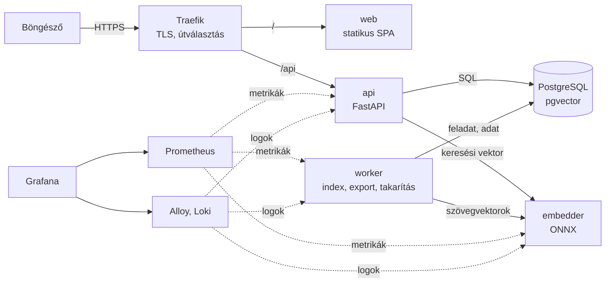
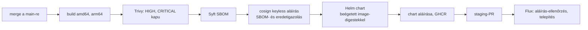

# Open Notebook – projektterv

| | |
|---|---|
| Állapot | Tervezet, jóváhagyásra vár |
| Dátum | 2026-11-22 |
| Hatókör | Az alkalmazás és a teljes DevOps-folyamat megtervezése |

A dokumentumban szereplő memória-, teljesítmény- és időértékek **tervezési becslések**, amíg a `docs/evidence/` mérés nem támasztja alá őket.

## Tartalom

1. [Cél és hatókör](#1-cél-és-hatókör)
2. [Keretfeltételek](#2-keretfeltételek)
3. [Felhasználói folyamatok](#3-felhasználói-folyamatok)
4. [Architektúra](#4-architektúra)
5. [Adatmodell és üzleti szabályok](#5-adatmodell-és-üzleti-szabályok)
6. [Háttérfeladatok, keresés, PDF](#6-háttérfeladatok-keresés-pdf)
7. [Felhasználói élmény és arculat](#7-felhasználói-élmény-és-arculat)
8. [Repository és helyi környezet](#8-repository-és-helyi-környezet)
9. [Tesztelés és CI](#9-tesztelés-és-ci)
10. [Ellátási lánc és titokkezelés](#10-ellátási-lánc-és-titokkezelés)
11. [Telepítés, környezetek, GitOps](#11-telepítés-környezetek-gitops)
12. [IaC és konfigurációkezelés](#12-iac-és-konfigurációkezelés)
13. [Megfigyelhetőség és SLO](#13-megfigyelhetőség-és-slo)
14. [Megbízhatóság és helyreállítás](#14-megbízhatóság-és-helyreállítás)
15. [AI-támogatott munkafolyamat](#15-ai-támogatott-munkafolyamat)
16. [Megvalósítási fázisok](#16-megvalósítási-fázisok)
17. [Követelmények nyomon követése](#17-követelmények-nyomon-követése)
18. [Kockázatok](#18-kockázatok)
19. [Nyitott döntések és felületen végzendő lépések](#19-nyitott-döntések-és-felületen-végzendő-lépések)

## 1. Cél és hatókör

Az Open Notebook strukturált, Markdown-alapú jegyzetelő, amelyben a jegyzet nem vész el (verziók, lomtár), jelentés alapján is megtalálható (hibrid keresés), és igényes PDF-ként elvihető.

**Benne van:** a hat specifikált funkciócsoport és a kiírás teljes DevOps-köre.

**Nincs benne:** valós idejű közös szerkesztés, megosztás, fájlcsatolmány, mobilalkalmazás, publikus felhős üzemeltetés, e-mail-küldés. Ezek egy fő számára túl nagyok, vagy az értékelt képességekhez nem tesznek hozzá.

## 2. Keretfeltételek

| Tény (felmérve 2026-11-22) | Tervezési következmény |
|---|---|
| Apple Silicon (arm64), 8 GB RAM | Könnyű komponensek, rögzített memóriakeret |
| Docker VM: 8 CPU, kb. 3,8 GiB | A klaszternek ebben futnia kell; 5 GB kényelmesebb |
| kb. 27 GB szabad lemez | Karcsú image-ek, rövid megőrzési idők |
| Nincs Homebrew, Node, Helm, OpenTofu, Ansible | Az eszközök verziózott **toolbox konténerből** futnak, a gépre semmi sem települ |
| Publikus, üres GitHub-repó | Ingyenes Actions, GHCR és nyilvános attestation használható |
| Az értékelő környezete ismeretlen | Elvárás csak Docker, git és make; image-ek `amd64` és `arm64` platformra |

## 3. Felhasználói folyamatok

| # | Folyamat | Lépések | Automatizált igazolás |
|---|---|---|---|
| F1 | Írás, verziózás, visszaállítás | mappa, notebook, szakasz, oldal létrehozása → két mentés → verziók összevetése → az első visszaállítása új verzióként | Playwright, API-teszt |
| F2 | Keresés jelentés alapján | mentés → worker indexel → más szavakkal megfogalmazott keresés megtalálja → szűrés notebookra | Playwright, keresésminőség-teszt |
| F3 | Notebook exportja | export indítása → állapotkövetés → letöltés → a PDF-ben tartalomjegyzék és oldalszámok | Playwright, PDF-elemző teszt |
| F4 | Törlés és helyreállítás | notebook lomtárba → eltűnik a fából és a keresésből → visszaállítás → ismét kereshető | Playwright, API-teszt |
| **H1** | Worker-leállás export közben | a worker kényszerített leállítása → bérlet lejár → másik példány befejezi; nincs dupla eredmény | Integrációs teszt, klasztergyakorlat |
| **H2** | Embedder kiesése | a keresés teljes szöveges módra vált és jelzi → a mentés működik → helyreállás után az elmaradt indexelés pótlódik | Integrációs teszt, klasztergyakorlat |
| **H3** | Szerkesztési ütközés | két lap ugyanazt az oldalt menti → a második `409`-et kap → mindkét szöveg megmarad, a felhasználó dönt | API-teszt, Playwright |
| **H4** | Teljes klasztervesztés | klaszter törlése → újraépítés kódból → adatvisszaállítás mentésből → ellenőrzés | DR-gyakorlat mért RTO/RPO-val |

## 4. Architektúra



| Komponens | Technológia | Miért |
|---|---|---|
| `web` | React, TypeScript, Vite; statikus kiszolgálás non-root konténerből | Gazdag szerkesztői felület, külön skálázható és gyorsítótárazható |
| `api` | Python, FastAPI, SQLAlchemy, Alembic | Típusos, OpenAPI-szerződést ad; a Python a keresés és a PDF ökoszisztémája is |
| `worker` | Ugyanaz a Python-kódbázis, külön belépési pont és image | A lassú munka nem foglalja az API-t; külön skálázható és hibázhat |
| `embedder` | ONNX Runtime, `multilingual-e5-small` (kvantált) | Magyarul is működik, CPU-n fut; a modell környezetenként egyszer van memóriában |
| Adat | PostgreSQL pgvectorral | Tartós adat, teljes szöveges index, vektor és feladatsor **egy** tranzakciós rendszerben |

### 4.1 Fő döntések (ADR-ként készülnek)

| ADR | Döntés | Elvetett alternatíva és ok |
|---|---|---|
| 0001 | Monorepó | Több repó: egy főnél csak szinkronizációs teher |
| 0002 | Moduláris Python-mag két belépési ponttal | Mikroszolgáltatások: nincs független csapat vagy kiadási ütem |
| 0003 | PostgreSQL-alapú feladatsor (`SKIP LOCKED`, bérlet) | Redis/RabbitMQ: plusz állapot és memória; elveszne a mentéssel közös tranzakció |
| 0004 | pgvector és PostgreSQL FTS, RRF-összevonás | Elasticsearch/Qdrant: a memóriakeretet meghaladná, kettős írást okozna |
| 0005 | Külön embedder szolgáltatás | Modell az api-ban és a workerben: dupla memória, nincs tiszta hibahatár |
| 0006 | PDF: WeasyPrint | Headless Chromium: nagy image és memória; a WeasyPrint natívan ad oldalszámos tartalomjegyzéket |
| 0007 | Kész PDF a PostgreSQL-ben, lejárattal, port mögött | Objektumtár: rövid életű, kis fájlokhoz külön állapotos rendszer. A port miatt S3-ra cserélhető |
| 0008 | Flux CD | Argo CD: nagyobb memóriaigény a felülete miatt. A Flux natívan ellenőriz cosign-aláírást, kezel függőséget és automatikus visszagörgetést |
| 0009 | A kiadás egysége aláírt OCI Helm chart, benne image-digestek | Külön mozgatott image-tagek: nem garantált az összetartozás |
| 0010 | Telepítéskor generált titkok | SOPS/Sealed Secrets: privát kulcs nélkül az értékelő nem tudná reprodukálni a környezetet |
| 0011 | Rétegek: Ansible (gazda, k3d) → OpenTofu (klaszteralap) → Flux (alkalmazás) | Minden egy eszközben: összemosott életciklusok; a klaszterre épülő provider nem konfigurálható ugyanabban a tervben megbízhatóan |
| 0012 | Toolbox konténer | Gépre telepített eszközök: nem reprodukálható, és a gépre telepítést kerüljük |
| 0013 | Munkamenet-süti és tulajdonosi szűrés (D1 jóváhagyásától függ) | Külső identitásszolgáltató: aránytalan |

### 4.2 Kódszerkezet

A backend portokra és adapterekre épül; a függés mindig befelé mutat, amit `import-linter` szabály kényszerít ki a CI-ban.

```text
domain/          entitások, értékobjektumok, szabályok (tiszta Python)
application/     használati esetek, portok (Protocol): PageRepository, JobQueue,
                 EmbeddingProvider, DocumentRenderer, ArtifactStore, Clock
infrastructure/  adapterek: postgres, embedder kliens, weasyprint
entrypoints/     api (FastAPI), worker, cli (migráció, admin)
```

Minden új export- vagy feladattípus új kezelő regisztrálásával adható hozzá, a feldolgozó ciklus módosítása nélkül (nyílt/zárt elv).

### 4.3 Memóriakeret (becslés)

| Elem | MiB |
|---|---:|
| k3s vezérlősík, Traefik | 550 |
| Flux (4 vezérlő) | 180 |
| Prometheus, Grafana, Loki, Alloy, kube-state-metrics | 580 |
| prod: PostgreSQL, api ×2, worker, embedder, web | 835 |
| staging: ugyanez, api ×1 | 705 |
| Docker VM alapfogyasztás | 350 |
| **Összesen** | **3200** |

A 3,8 GiB-os keretbe belefér, de kevés tartalékkal. Az E2E- és a teljes körű gyakorlatok ezért CI-futtatón is lefutnak; helyben `PROFILE=lite` módban a staging leskálázható.

## 5. Adatmodell és üzleti szabályok

| Tábla | Tartalom |
|---|---|
| `users`, `sessions` | fiók (Argon2id jelszókivonat), kivonatolt munkamenet-azonosító |
| `nodes` | fa: `id, owner_id, kind, parent_id, parent_kind, title, position, trashed_at, trash_root_id` |
| `pages` | `node_id, current_version_id` |
| `page_versions` | csak bővülő: `page_id, number, title, content_md, content_hash, restored_from` |
| `search_chunks` | `page_id, version_id, notebook_id, owner_id, text, tsv, embedding vector(384)` |
| `jobs` | `kind, payload, dedupe_key, state, attempts, run_after, leased_until, progress, error` |
| `exports` | `job_id, scope_node_id, state, artifact, expires_at` |

**Hierarchia.** Mappa mappában vagy gyökérben; notebook mappában vagy gyökérben; szakasz notebookban; oldal szakaszban. A szabályt összetett idegen kulcs (`parent_id, parent_kind`) és `CHECK` biztosítja, a körmentességet a használati eset ellenőrzi zárolás alatt.

**Verziók.**
- Minden mentés új, változtathatatlan verzió. Az azonos tartalmú ismételt kérés nem hoz létre új verziót (idempotencia).
- A mentés tartalmazza az alapverziót; eltérésnél `409 Conflict`, a szerver semmit sem ír felül.
- A visszaállítás új verziót hoz létre a régi tartalommal, így maga is visszavonható.
- A szerkesztő tétlenségkor automatikusan ment; a még nem mentett szöveg helyi piszkozatként túléli a lapbezárást. Az idővonal a közeli verziókat csoportosítja.

**Lomtár.**
- A törlés a teljes részfát egy `trash_root_id` alá sorolja; a lomtár csak a gyökereket mutatja.
- A korábban külön törölt elem megtartja saját gyökerét, ezért a szülő visszaállítása nem hozza vissza.
- Ha a visszaállítandó elem szülője a lomtárban van, az API `409 parent_trashed` választ ad, és a felület új helyet kínál.
- 30 nap után a worker véglegesen töröl. A lomtárban lévő tartalom nem kereshető.

## 6. Háttérfeladatok, keresés, PDF

**Feladatsor.** A feladat a kiváltó művelettel **azonos tranzakcióban** jön létre. A worker `FOR UPDATE SKIP LOCKED` zárolással vesz ki feladatot, `LISTEN/NOTIFY` ébreszti, bérletet tart és szívverést küld. Hiba esetén exponenciális várakozás véletlen szórással; a próbálkozások után `dead` állapot, amely metrikában és riasztásban látszik. A végrehajtás legalább egyszeri, ezért minden kezelő idempotens. `SIGTERM` esetén nem vesz fel új munkát, és visszaadja a bérletet.

**Indexelés.** Mentés → `index_page` feladat (oldalanként összevonva) → Markdown-tagolás címsorok szerint → vektorok → a régi darabok cseréje egy tranzakcióban, csak ha még mindig az a legfrissebb verzió.

**Keresés.** Párhuzamosan fut a teljes szöveges (magyar és angol szótövezés, ékezetfüggetlen) és a vektoros (koszinusz) lekérdezés; az eredményt Reciprocal Rank Fusion egyesíti, kiemelt részlettel. Kezdetben pontos vektorkeresés, mert a felhasználónkénti darabszám kicsi; HNSW-index csak mérés alapján. Az embedder hibája vagy időtúllépése esetén `mode: "fulltext"` és jelzés a felületen.

**Keresésminőség.** Rögzített magyar/angol mintakészlet; a CI elbukik, ha a recall@5 vagy az MRR a küszöb alá esik.

**PDF-export.** `queued → running (haladás %) → succeeded | failed → expired`. Markdown → HTML (nyers HTML tiltva, kimenet tisztítva) → WeasyPrint. Címlap, oldalszámos tartalomjegyzék, PDF-könyvjelzők, élőfej. A megjelenítő **semmilyen külső erőforrást nem tölthet be** (SSRF-védelem). A letöltési link aláírt és lejár; a fájlt a takarító feladat törli. A tartalom az indításkori verziók pillanatképe.

## 7. Felhasználói élmény és arculat

**Alapgondolat: „nyitott lap, csendes tér".** Az Apple-től a nagy levegő, a pontos tipográfia, az áttetsző rétegek és a visszafogott mozgás jön; a saját hang a papír és a tinta melegsége.

- **Logó:** nyitott füzet két íves lapja, amelyek negatív terében „O" betű rajzolódik ki; a gerincnél egy könyvjelzőnyi színes csík. SVG, egyszínű és favicon változat.
- **Színek:** meleg papírfehér és mély tintakék alap, egyetlen élénk hangsúlyszín (cinóber könyvjelző). Sötét módban „éjjeli íróasztal" árnyalatok. Minden pár WCAG AA kontrasztú.
- **Betűk:** felületen rendszerbetű; oldalcímekben és a PDF-ben saját kiszolgálású, szabad licencű könyvbetű.
- **Elrendezés:** három hasáb (könyvtár, oldallista, szerkesztő), összecsukható; fókuszmód; keskeny képernyőn egymásra csúszó nézetek.
- **Kulcsfelületek:** ⌘K kereső és parancspaletta, fa húzással rendezve, verzióidővonal összevetéssel, lomtár, exportközpont, beszédes üres állapotok.
- **Szerkesztő:** Markdown-natív WYSIWYG (Milkdown) és nyers Markdown mód. A Markdown oda-vissza alakításának hűségét a 3. fázis elején próba igazolja; ha nem megfelelő, CodeMirror élő előnézettel.
- **Állapotok:** mentési jelzés, kapcsolat nélküli piszkozat, degradált keresés, ütközésfeloldás – minden hibának van emberi szövege és következő lépése.
- **Akadálymentesség:** teljes billentyűzetkezelés, látható fókusz, `prefers-reduced-motion`, axe-ellenőrzés az E2E-tesztekben.

## 8. Repository és helyi környezet

```text
.
├── CLAUDE.md  README.md  Makefile  VERSION
├── .github/workflows/
├── backend/            Python: api, worker (src/, tests/, migrations/, uv.lock)
├── embedder/           Python: ONNX-szolgáltatás
├── web/                React-alkalmazás, Playwright-tesztek
├── compose/            fejlesztői környezet, reverse proxy
├── deploy/
│   ├── charts/         open-notebook (alkalmazás), open-notebook-data (PostgreSQL, mentés)
│   ├── platform/       megfigyelhetőség
│   ├── envs/           staging/, prod/   ← a kívánt állapot
│   └── flux/           Flux-források és függőségek
├── infra/
│   ├── ansible/        gazdagép-előkészítés, k3d, üzemeltetési playbookok
│   └── tofu/           cluster/, github/
├── observability/      szabályok, dashboardok, promtool-tesztek
├── load/               k6-forgatókönyvek
├── tools/toolbox/      pinelt eszközöket tartalmazó image
└── docs/               adr/ ai/ evidence/ runbooks/ incidents/ architecture.md security.md slo.md
```

**Fejlesztés:** `git clone` → `make dev`. A cél véletlen értékű, gitignore-olt `.env`-et készít, felépíti az image-eket, migrál, és betölti a mintaadatokat. Automatikus újratöltés az api-nál és a webnél; állapotellenőrzések és indítási sorrend Composeban. TLS-sel a reverse proxy mögött, hogy a fejlesztői útvonal a telepítettet tükrözze.

**Toolbox:** egyetlen image, checksummal ellenőrzött, rögzített verziójú eszközökkel (k3d, helm, flux, tofu, ansible, cosign, syft, trivy, gitleaks, k6, kubeconform, promtool, actionlint). Helyben és a CI-ban ugyanez fut. A Docker-socket felcsatolása a gazdagépen rendszergazdai jogkört jelent; ez csak fejlesztői gépen elfogadott, a `docs/security.md` rögzíti.

## 9. Tesztelés és CI

| Szint | Mit bizonyít | Eszköz |
|---|---|---|
| Egység | domain- és alkalmazásszabályok | pytest, Vitest |
| Architektúra | a függési irány betartása | import-linter |
| Integráció | valódi PostgreSQL: sor, bérlet, tranzakció, keresés, tulajdonosi szűrés | pytest szolgáltatáskonténerrel |
| Szerződés | az API megfelel az OpenAPI-leírásnak; a kliens ebből generált | Schemathesis, generált TypeScript-kliens |
| Migráció | üres adatbázisból és az előző kiadásból is; régi kód az új sémán | Alembic, kompatibilitási teszt |
| Keresésminőség | recall@5, MRR küszöb | rögzített mintakészlet |
| E2E | F1–F4, H3 és akadálymentesség | Playwright, axe |
| Telepítés | chartok érvényessége, biztonsági beállítások | helm lint, kubeconform, Trivy config |
| Megfigyelhetőség | riasztási szabályok helyes működése | promtool test rules |
| Tiszta környezet | üres futtatón klaszter, telepítés, füstteszt | k3d a CI-ban |

Lefedettségi küszöb: domain és application réteg 90%, backend összesen 80%.

**Workflow-k**

| Workflow | Indítás | Feladat |
|---|---|---|
| `ci` | PR, kézi | lint, típus, tesztek, image-build, vizsgálat, E2E; összesítő kötelező ellenőrzés |
| `security` | PR, heti | CodeQL, gitleaks, függőség- és image-vizsgálat |
| `clean-room` | PR (telepítést érintő), heti | teljes reprodukció nulláról |
| `release` | push a `main`-re | build, vizsgálat, SBOM, aláírás, chart, staging-PR |
| `promote` | kézi | prod-PR ugyanazzal a chartverzióval, kiadási jegyzet |
| `drill` | kézi, havi | mentés, rombolás, visszaállítás, RTO/RPO-mérés |

Teszteredmények, lefedettség, Playwright-nyomok, SBOM-ok és vizsgálati jelentések CI-artifactként elérhetők.

## 10. Ellátási lánc és titokkezelés



- **Verzió:** `VERSION` (MAJOR.MINOR) és a futás sorszáma, pl. `0.1.57`. Minden main-merge teljes értékű kiadásjelölt; a promóció nem buildel újra.
- **Bizalmi lánc:** a Flux csak a repó `release` workflow-ja által aláírt chartot fogadja el; a chart digesttel rögzíti az image-eket, így az ellenőrzés rájuk is kiterjed.
- **Kapuk:** javítható HIGH/CRITICAL sérülékenység megállítja a kiadást; kivétel csak indoklással és lejárattal.
- **Negatív bizonyíték:** aláíratlan chart telepítési kísérlete dokumentáltan elbukik.
- **Frissítés:** Dependabot a Python-, npm-, Docker- és Actions-függőségekre.

**Titkok.** Nincs hosszú életű titok Gitben vagy GitHub Secretben: a GHCR-hez a futás idejű `GITHUB_TOKEN`, az aláíráshoz OIDC szolgál. Az adatbázisjelszavakat, az aláíró kulcsot és a Grafana-jelszót az OpenTofu generálja ephemeral értékként, write-only attribútummal, így a state-be sem kerülnek. Rotáció: a revízió növelése és újraindítás; kipróbált runbookkal. A gitleaks commit előtt és a CI-ban a teljes történeten fut.

## 11. Telepítés, környezetek, GitOps

**Elkülönítés.** `open-notebook-staging` és `open-notebook-prod` névtér: külön adatbázis, titkok, kvóta, hosztnév, alapból tiltó NetworkPolicy és `restricted` Pod Security szint. Egy klaszterben vannak a memóriakeret miatt; a korlátot (közös vezérlősík) az ADR kimondja.

| | staging | prod |
|---|---|---|
| Cím | `https://staging.open-notebook.localhost:8443` | `https://open-notebook.localhost:8443` |
| api példány | 1 | 2 és PodDisruptionBudget |
| Frissítés | automatikus PR sikeres kiadás után | kézi promóció jóváhagyott PR-ral |
| Mentés | nincs (mintaadat) | óránként |

**Kiadási folyamat**
1. A `release` workflow PR-t nyit, amely a `deploy/envs/staging` chartverzióját emeli. A PR ellenőrzéseit `workflow_dispatch` indítja (a `GITHUB_TOKEN` által nyitott PR magától nem indít workflow-t), majd automatikusan összeolvad. Nem kell személyes token vagy szabálymegkerülés.
2. A Flux telepít: adat-chart → migrációs Job → alkalmazás → Helm-teszt (F1 rövidített változata).
3. A `promote` workflow ugyanazt a verziót emeli PR-ban a prodba; előtte ellenőrzi az aláírást és a sikeres staging-állapotot.

**Visszaállítás.** Automatikus: sikertelen frissítés vagy Helm-teszt esetén a Flux visszagörget az előző kiadásra. Kézi: `git revert` a promóciós commiton. Mindkettőt szándékosan hibás kiadással próbáljuk ki. Az adatbázis nem görög vissza: az expand/contract migráció miatt az előző verzió az új sémán is fut, és migráció előtt automatikus mentés készül.

**Eltérés-kezelés.** Kézi `kubectl scale` után a Flux visszaállítja a kívánt állapotot; a kísérlet bizonyítékként rögzül.

## 12. IaC és konfigurációkezelés

| Réteg | Eszköz | Felelősség | Reprodukálhatóság igazolása |
|---|---|---|---|
| Gazda | Ansible | előfeltételek, helyi CA és tanúsítvány, könyvtárak, k3d-klaszter deklaratív konfigból; mentés, visszaállítás, DR-playbook | második futás `changed=0`, CI ellenőrzi |
| Klaszteralap | OpenTofu `cluster` | névterek, kvóták, Pod Security, titkok, TLS, Flux telepítése | `plan -detailed-exitcode` = 0 alkalmazás után |
| GitHub | OpenTofu `github` | ágvédelem, környezetek, repó-beállítások | `plan` eltérés nélkül |
| Alkalmazás | Flux, Helm | minden, ami a névterekben fut | Flux `Ready`, eltérés-kísérlet |

Az OpenTofu state helyi és gitignore-olt: egy felhasználó van, a klaszter eldobható, távoli tárhely pedig külső függőség lenne. A provider-lockfile commitolt, több platform kivonatával. A `tofu test` és a Trivy a modulokat is vizsgálja.

## 13. Megfigyelhetőség és SLO

- **Metrikák:** HTTP RED; feladatsor mélysége, kora, időtartama, kimenete; keresési mód és fázisonkénti idő; embedder-idő; export-kimenet; PostgreSQL-kapcsolatok; `build_info` verzióval.
- **Naplók:** JSON, egységes mezőkkel (`ts, level, service, version, env, request_id, job_id, event`). A `request_id` a böngészőtől a háttérfeladatig követhető. Jegyzettartalom és keresőkifejezés **nem** kerül a naplóba.
- **Dashboardok kódból:** szolgáltatásáttekintés, SLO és hibakeret, feladatsor, kiadások.
- **Riasztások:** többablakos hibakeret-égés, feladatsor kora, `dead` feladat, elavult mentés; mindegyikhez runbook-link és promtool-teszt. Az értesítés helyben a Prometheus/Grafana felületén látszik, külső csatorna nincs.

| SLI | SLO (28 nap, kezdeti célérték) |
|---|---|
| Nem 5xx API-válaszok aránya | 99,5% |
| Keresés 500 ms alatt | 95% |
| Mentés 300 ms alatt | 99% |
| Mentéstől kereshetőségig 30 s alatt | 95% |
| Export sikeresen, 60 s alatt | 98% |

A célokat a terheléses mérés után véglegesítjük. Rövid életű helyi klaszterben 28 napos adat nem gyűlik; ezt a bizonyíték kimondja, és a terhelési ablakra számolt megfelelést mutatja.

## 14. Megbízhatóság és helyreállítás

- **Terhelés (k6):** alap, csúcs, tartós; a küszöbök az SLO-k. Telítési pont és szűk keresztmetszet azonosítása, legfeljebb egy mérésre alapozott javítással, előtte–utána adattal.
- **Hibagyakorlatok:** H1, H2, adatbázis-újraindítás, hibás kiadás, betelt kvóta. Mindegyiknél hipotézis, végrehajtás, észlelés, hatás, helyreállási idő.
- **Mentés:** óránkénti `pg_dump`, ellenőrző összeggel, a klaszteren kívüli könyvtárba (túléli a klaszter törlését); megőrzés 24 órás és 7 napi.
- **Célok:** RPO ≤ 1 óra, RTO ≤ 15 perc, mért eredménnyel.
- **DR-gyakorlat:** ismert adatkészlet → mentés → klaszter törlése → `make cluster` → visszaállítás → sorszám- és tartalomkivonat-egyezés → keresés és verzió-visszaállítás füstteszt. A keresőindex származtatott adat, ezért újraépíthető.
- **Korlát:** a mentés ugyanazon a fizikai gépen van; valós üzemben külső, titkosított tárhely kellene.
- **Incidenselemzés:** egy valóban lefolytatott gyakorlatról, hibáztatásmentesen: idővonal, hatás, kiváltó és hozzájáruló okok, mi működött, felelőssel és határidővel ellátott teendők.

## 15. AI-támogatott munkafolyamat

Az AI tervez és kódol, a hallgató dönt és átvesz, az automatizált kapuk mindkettőjüktől függetlenül ellenőriznek.

- **Irányítás:** `CLAUDE.md` mint verziózott munkautasítás; jelentős döntés ADR-ben.
- **Ellenőrzés:** minden AI-változtatás ugyanazokon a kapukon megy át; a hallgató fázisonként PR-t néz át, és észrevételeit a PR-ban rögzíti.
- **Napló:** `docs/ai/log.md` – feladat, javaslat, döntés, ellenőrzés, feltárt hiba és javítása.
- **Összegzés:** `docs/ai/summary.md` – mire volt jó, hol tévedett, mely hibát melyik kapu fogta meg, mit kellett emberi döntéssel felülbírálni.
- **Adatvédelem:** az AI titkot és személyes adatot nem kap; a naplóban csak valóban megtörtént emberi átnézés szerepel.

## 16. Megvalósítási fázisok

Állapot: ☐ tervezett · ◐ folyamatban · ☑ igazolva

| # | Fázis | Fő eredmény | Kész, ha | Állapot |
|---|---|---|---|---|
| 0 | Alapozás | repóváz, toolbox, Makefile, gitleaks és commit-ellenőrzés, ADR-sablon | tiszta klónban `make check` lefut csak Dockerrel, gittel és make-kel | ☐ |
| 1 | Működő váz és CI | api, worker, web, PostgreSQL „végig bekötve" Composeban; `ci` workflow | `make dev` után health zöld; a CI zöld és szándékos hibára piros | ☐ |
| 2 | Jegyzetelés | hierarchia, verziók, lomtár, (D1) belépés – API és tesztek | F1, F4, H3 API-teszt zöld; lefedettségi küszöb teljesül | ☐ |
| 3 | Felület | arculat, logó, szerkesztő, fa, idővonal, lomtár | F1, F4, H3 Playwrighttal; axe hibátlan | ☐ |
| 4 | Keresés | feladatsor, indexelés, embedder, hibrid keresés, ⌘K | F2, H2 teszt zöld; keresésminőségi küszöb teljesül | ☐ |
| 5 | PDF-export | renderelő, állapot, letöltés, takarítás | F3, H1 teszt zöld; SSRF-teszt zöld | ☐ |
| 6 | Ellátási lánc | többplatformos image, vizsgálat, SBOM, aláírás, chart-kiadás | `cosign verify` sikeres; aláíratlan elbukik | ☐ |
| 7 | Kubernetes | chartok, k3d, Ansible, OpenTofu, NetworkPolicy | `make cluster` nulláról működik; második futás változásmentes | ☐ |
| 8 | GitOps | Flux, staging/prod, promóció, visszagörgetés | hibás kiadás automatikusan visszaáll; `git revert` kipróbálva | ☐ |
| 9 | Megfigyelhetőség | metrikák, naplók, dashboard, SLO, riasztás | promtool zöld; egy kérés naplója végigkövethető | ☐ |
| 10 | Megbízhatóság | terhelés, hibagyakorlatok, DR, incidenselemzés | mért RTO/RPO; k6-jelentés; H1, H2, H4 bizonyíték | ☐ |
| 11 | Lezárás | README, bizonyítékjegyzék, AI-összegzés, tisztakörnyezet-próba | friss klónból a README lépései szó szerint működnek | ☐ |

A metrika és a strukturált log már az 1. fázistól a kód része; a 9. fázis a gyűjtésüket és értelmezésüket adja. A fázisok sorrendje miatt bármelyik után működő, bemutatható állapot marad.

## 17. Követelmények nyomon követése

| Terület | Pont | Hol teljesül | Bizonyíték |
|---|---:|---|---|
| É1 Rendszer és architektúra | 5 | 3–6. fejezet | `docs/architecture.md`, ADR-ek, F- és H-folyamatok |
| É2 Helyi környezet, repó | 5 | 8. fejezet | `clean-room` futás, README |
| É3 Tesztek, CI | 9 | 9. fejezet | CI-futások, lefedettség, szándékosan piros futás |
| É4 Artifact, biztonság, SBOM, titok | 7 | 10. fejezet | aláírás-ellenőrzés, SBOM, gitleaks, negatív próba |
| É5 Telepítés, környezetek, visszaállítás | 9 | 11. fejezet | frissítés- és visszagörgetés-jegyzőkönyv |
| É6 GitOps | 5 | 11. fejezet | promóciós PR-ok, eltérés-kísérlet |
| É7 IaC, konfiguráció | 5 | 12. fejezet | `changed=0`, üres `plan` |
| É8 Megfigyelhetőség | 7 | 13. fejezet | dashboardképek, SLO-jelentés, riasztási teszt |
| É9 Megbízhatóság | 4 | 14. fejezet | DR-jegyzőkönyv, k6, incidenselemzés |
| É10 AI-munkafolyamat | 4 | 15. fejezet | AI-napló és összegzés |

## 18. Kockázatok

| Kockázat | Kezelés |
|---|---|
| Kevés memória helyben | limitek, `PROFILE=lite`, Docker 5 GB-ra emelése, teljes gyakorlat a CI-ban |
| A hatókör túl nagy egy főnek | fázisonként működő állapot; a látványelemek az alapfunkciók után |
| A szerkesztő torzítja a Markdownt | korai próba oda-vissza tesztekkel, kész tartalékmegoldás |
| A modell letöltése nem elérhető | revízióra és SHA-256-ra rögzítve, image-be építve; futáskor nincs letöltés |
| Az automatikus staging-PR mechanizmusa nem a várt módon működik | 8. fázis elején próba; tartalék: kézzel összeolvasztott PR |
| A write-only titokkezelés provider-támogatása | 7. fázis elején próba; tartalék: klaszteren belüli generáló Job |
| Verziók elavulása a projekt alatt | Dependabot, fázis eleji hivatalos ellenőrzés |

## 19. Nyitott döntések és felületen végzendő lépések

| # | Döntés | Javaslat |
|---|---|---|
| D1 | Legyen-e belépés? A specifikáció nem említi. | Igen, minimálisan (e-mail, jelszó, munkamenet): privát jegyzethez elvárható, és utólag drága beépíteni |
| D2 | A felület nyelve | Magyar, szövegkatalógusból, később bővíthetően |
| D3 | Toolbox konténer a gépre telepített eszközök helyett | Igen; a gépre semmit sem kell telepíteni |
| D4 | Push és PR-nyitás állandó engedélye | Igen, a `main`-be olvasztás a hallgatónál marad (átnézési bizonyíték) |

| # | Felületen végzendő lépés | Mikor |
|---|---|---|
| L1 | Docker Desktop → Settings → Resources → Memory: 5 GB, Apply & restart | 7. fázis előtt (ajánlott) |
| L2 | GHCR-csomagok láthatósága: Public | az első kiadás után (6. fázis) |
| L3 | Fázisonkénti PR-átnézés és összeolvasztás | minden fázis végén |
